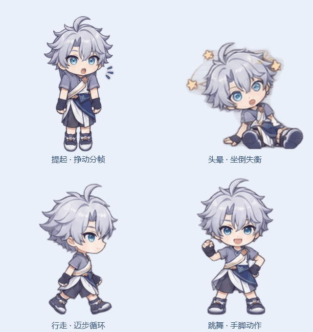

# 白厄 · Coopanion 原画互动角色包

银白发、青色眼睛的少年的桌宠形象包，包含 **304 张透明播放帧、19 种原生表情、18 种原生动作，以及抱抱、趴下、伸懒腰 3 种附加动作**。提起挣动、坐倒头晕、行走、跑步、挥手、鞠躬等使用对应的动作分帧，并接入 Coopanion 原生互动和物理逻辑。

**使用前必须先安装并运行 [Coopanion](https://github.com/Pal-AI-Lab/Coopanion)。本仓库提供的是可导入的角色包。**

- **Coopanion 官方仓库：** [Pal-AI-Lab/Coopanion](https://github.com/Pal-AI-Lab/Coopanion)
- **Coopanion 下载：** [官方最新版本](https://github.com/Pal-AI-Lab/Coopanion/releases/latest)
- **Coopanion 安装说明：** [官方中文 README](https://github.com/Pal-AI-Lab/Coopanion/blob/main/README_zh.md)
- **角色包下载：** [baie-native-1.0.0.zip](https://github.com/WWK-HUB/coopanion-baie-native/releases/latest/download/baie-native-1.0.0.zip)
- **所有下载与版本记录：** [Releases](https://github.com/WWK-HUB/coopanion-baie-native/releases)

## 帧数与流畅度

本版包含 **112 张原画关键帧（含 16 张静态姿势/表情）和 192 张光流补间帧，共 304 张透明播放帧**，不将补间帧算作新绘制的原画。

| 动作组 | 原画关键帧 | 播放帧 |
| --- | ---: | ---: |
| 行走、跑步、跳跃、跳舞、提起、挥手、点头、摇头、鞠躬、休息过渡（每组） | 8 | 24 |
| 坐倒头晕 | 16 | 48 |
| 静态姿势与表情 | 16 | 16 |

循环动作通常按 24 fps 播放，跑步按 30 fps；短动作的总时长沿用原生引擎的节奏。补间在离线构建时计算，运行时直接播放透明 WebP 帧，不要求使用者安装光流工具。大幅度肢体运动采用较近的变形源图处理遮挡，减少半透明双影。原画之间仍可能存在少量形体差异，实际观感可先用离线预览检查。

## 角色预览

### 动画：提起、头晕、行走、跳舞

<p align="center">
  
</p>

### 站立、挥手、被提起

<table>
  <tr><th>站立</th><th>挥手</th><th>被提起</th></tr>
  <tr>
    <td></td>
    <td></td>
    <td></td>
  </tr>
  <tr><th>坐倒头晕</th><th>趴着睡觉</th><th>抱抱</th></tr>
  <tr>
    <td></td>
    <td></td>
    <td></td>
  </tr>
</table>

### 原生沙箱运行预览

下面的截图来自 Coopanion 原生形象沙箱，展示角色包实际加载后的挥手动作。


全部关键帧可查看 [动作帧总览](preview/keyframes.jpg)。

## 第一步：安装 Coopanion

1. 前往 [Coopanion 官方 Releases](https://github.com/Pal-AI-Lab/Coopanion/releases/latest)，下载适合自己操作系统的软件。
2. Windows 可选择安装程序，或下载便携版 ZIP、完整解压后启动 `Coopanion.exe`。其他系统的安装步骤以 [官方中文说明](https://github.com/Pal-AI-Lab/Coopanion/blob/main/README_zh.md) 为准。
3. 启动 Coopanion，按照软件提示完成首次设置，确认桌面上能看到桌宠。

角色包自身不包含 Coopanion 主程序。导入和使用本包不需要安装 Python、Node.js 或运行仓库中的构建脚本。AI 对话、语音等功能按照 Coopanion 自身的说明配置。

## 第二步：导入白厄角色包

### 推荐：直接导入角色 ZIP

1. 下载 [baie-native-1.0.0.zip](https://github.com/WWK-HUB/coopanion-baie-native/releases/latest/download/baie-native-1.0.0.zip)。**直接选择这个角色 ZIP 即可，无需先解压。**
2. 在 Coopanion 中右键桌宠，打开 **「装扮」** 页面；也可以从设置窗口进入装扮页。
3. 在装扮页点击 **导入形象包**，选择刚下载的 `baie-native-1.0.0.zip`。软件也支持把 ZIP 拖入装扮页。
4. 导入列表识别出 **「白厄 · 原画互动版」** 后，选中并确认导入。
5. 回到形象列表，选择 **「白厄 · 原画互动版」**，桌面上的角色即切换为白厄。

### 备选：从源码文件夹导入

如果下载了整个仓库的源码 ZIP，先将仓库完整解压，再在 Coopanion 装扮页选择文件夹导入，指向仓库内的 **`baie-native/` 文件夹**。这个文件夹的根目录应当直接包含：

```text
baie-native/
├── figure.json
├── figure.js
└── assets/
```

角色 ZIP 与 GitHub 的仓库源码 ZIP 用途不同：日常使用请优先下载 Releases 中的 `baie-native-1.0.0.zip`。

## 第三步：体验互动

| 操作 | 对应表现 |
| --- | --- |
| 轻点角色 | 原生戳一戳反应，随机表情或蹦跳 |
| 在头部来回移动鼠标 | 摸头，触发喜欢或害羞等反应 |
| 按住并拖动 | 提起，身体悬挂、手臂下垂、双腿交替挣动，24 帧循环 |
| 快速甩动后松开 | 抛出与跌落，使用原生重力和边界碰撞 |
| 重重落地 | 跌落 → 48 帧坐倒失衡 → 回神摇头 → 恢复站立 |
| 睡觉时轻点 | 被戳醒，接坐起、受惊和起身动作 |
| 自由活动 / 移动指令 | 左右行走、跑步、跳跃等 |
| 请求挥手、点头、鞠躬、跳舞 | 对应的专门动作帧 |

部分相近表情共用原画姿势，再通过局部表情、次级动作或特效区分。音效沿用 Coopanion 原生合成音效。

## 无需安装软件的动作预览

想先看全部动作，可以下载 [离线互动预览 baie-preview.html](https://github.com/WWK-HUB/coopanion-baie-native/releases/latest/download/baie-preview.html)，保存后用现代桌面浏览器打开。预览页可以逐项选择 40 个表情与动作，也支持实际拖拽、抛出、摸头和戳醒。

离线预览用于查看动画；在桌面上使用角色仍然需要先安装 Coopanion，再导入角色包。

## 兼容性与验证

- 形象包格式：`manifest: 2`、`api: 2`；角色 ID：`baie-native`。
- 使用本地 **Coopanion 0.2.17** 的原生导入器、互动引擎和沙箱验证。
- 原生 ZIP 导入暂存：识别 1 个角色包、307 个文件，未报告格式问题或跳过项。
- 40 个表情与动作指令全部被接受，Chromium 中无脚本异常。
- 已验证原生指针接口的戳、摸头、提起、抛出、重摔头晕、恢复和戳醒流程。
- 验证记录见 [`preview/`](preview/)。实际桌面窗口及跨屏拖动仍需在使用者的软件环境中体验。

如果导入时提示 API 或形象包格式不受支持，请先更新 Coopanion，再重新导入。

## 仓库内容与制作

```text
baie-native/       可直接导入的角色包源码与透明帧
source/               原始角色素材、补绘图和分切记录
preview/              动画 GIF、运行截图、验证记录与离线预览使用的引擎源码
build_assets.py       分切、统一锚点、计算双向光流补间
build_release.py      打包角色 ZIP、生成离线 HTML 和 SHA-256 校验文件
preview-template.html 离线互动预览模板
```

素材由角色包制作者提供，新增动作关键帧使用内置 imagegen 参照素材补绘。原始素材、补绘图、分切关键帧与 prompt-1.txt 至 prompt-4.txt 生成提示词均保留在 [source/](source/) 中。

开发时可安装 `requirements-dev.txt` 中的依赖，运行 `python build_assets.py` 重新分切素材，或运行 `python build_release.py` 从现有帧生成 `dist/` 下载文件。普通使用者直接下载 Releases 中的角色包即可。

## 致谢

本角色包为社区制作的 Coopanion 形象包。桌宠主程序、形象包接口与原生互动引擎来自 **[Pal-AI-Lab/Coopanion](https://github.com/Pal-AI-Lab/Coopanion)**。离线预览使用的上游代码与许可信息见 [THIRD_PARTY_NOTICES.md](THIRD_PARTY_NOTICES.md)。
